  

### Hi, I'm ALshaimaa 👋

UI/UX designer who also codes. I like turning small everyday problems into simple apps.

### What I work with

  
  
  

### Featured

- **Mealo**: meal reminders and food-expiry tracking (UX case study)
- **SWE_project**: an educational app-like game in Dart

### Find me

[GitHub](https://github.com/Alshaimaa00)
